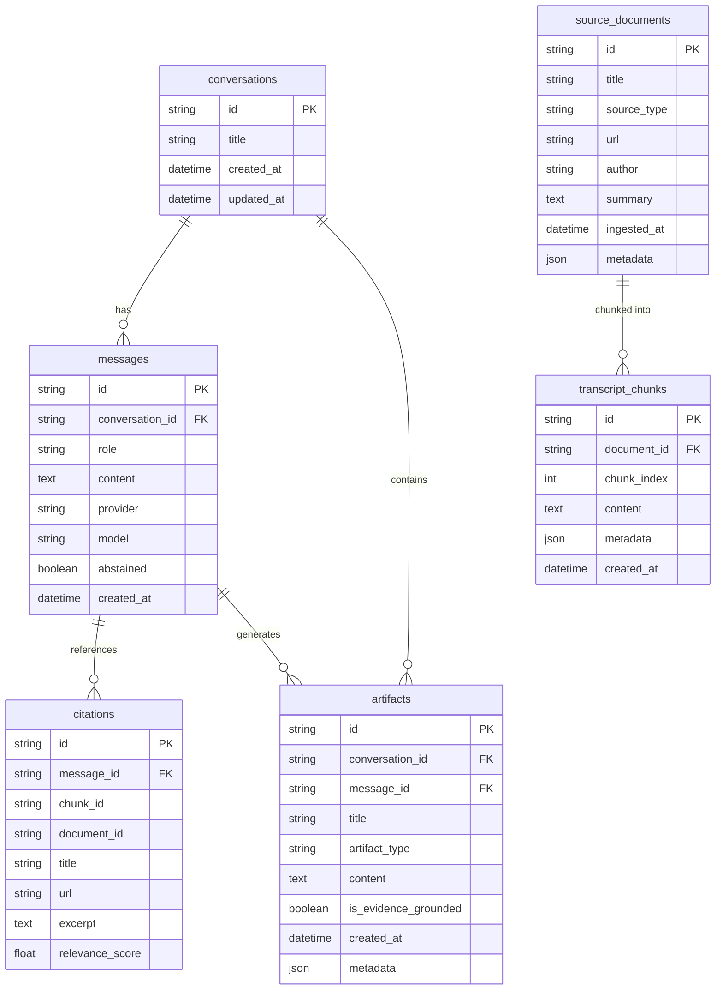

# System Architecture — The Lenny Growth Assistant

## 1. System Topology & Component Boundaries

```
┌────────────────────────────────────────────────────────────────────────────────────────┐
│                               FRONTEND (React + TypeScript + Vite)                     │
│  Sidebar (Sessions)  │  Chat Stream & Citations  │  Sandboxed Artifact Viewer (Iframe) │
└───────────────────────────────────────────┬────────────────────────────────────────────┘
                                            │ HTTP / JSON (Proxy :5173 -> :8000)
                                            ▼
┌────────────────────────────────────────────────────────────────────────────────────────┐
│                              BACKEND (FastAPI - Python 3.11)                           │
│                                                                                        │
│  [REST API Layer]                                                                      │
│   • /health, /api/providers, /api/conversations, /api/chat, /api/skills, /api/artifacts│
│                                                                                        │
│  [GrowthAgent Orchestration Layer]                                                     │
│   • Session Validation ──► Retrieval Search ──► Grounding Prompt ──► Persistence       │
│                                                                                        │
│  [Agent SDK Integrations & Provider Abstraction]                                       │
│   • ModelRouter                                                                        │
│       ├── OllamaProvider (Native HTTPX -> http://localhost:11434, qwen2.5:3b)          │
│       ├── PiCodingAgentProvider (Genuine pi_agent SDK integration)                     │
│       ├── AnthropicProvider (Claude 3.5 Sonnet / claude-agent-sdk)                     │
│       └── OpenAIProvider (GPT-4o-mini)                                                 │
│                                                                                        │
│  [Retrieval & Ingestion Engine]                                                        │
│   • Text & Frontmatter Parser (.md, .txt, .json)                                       │
│   • Paragraph-Aware Overlapping Chunker (700 chars / 150 overlap)                      │
│   • Hybrid PostgreSQL FTS (to_tsvector + GIN Index + ts_rank_cd) + Lexical Matcher     │
│   • Abstention Gate (Threshold: 0.05)                                                  │
└───────────────────────────────────────────┬────────────────────────────────────────────┘
                                            │ Psycopg 3 / SQLAlchemy
                                            ▼
┌────────────────────────────────────────────────────────────────────────────────────────┐
│                             DATABASE (PostgreSQL 18 - port 5432)                       │
│  • conversations, messages, citations, source_documents, transcript_chunks, artifacts  │
│  • GIN Index on transcript_chunks.content using english dictionary                     │
└────────────────────────────────────────────────────────────────────────────────────────┘
```

---

## 2. Database Schema Design (SQLAlchemy)



### Full-Text Search Index
PostgreSQL GIN Index on `transcript_chunks`:
```sql
CREATE INDEX IF NOT EXISTS idx_chunks_fts 
ON transcript_chunks 
USING gin(to_tsvector('english', content));
```

---

## 3. Ingestion & Retrieval Pipeline

1. **Document Ingestion:**
   - Supported extensions: `.md`, `.txt`, `.json`.
   - Frontmatter parsing extracts `id`, `title`, `source_type`, `url`, `author`.
   - Document replacement is idempotent (deletes previous version before chunk insertion).
2. **Chunking Strategy:**
   - Paragraph-boundary preserving split.
   - Chunk target: 700 characters with 150 characters of overlap.
   - Preserves exact document ID and sequential chunk index.
3. **Hybrid Search & Abstention:**
   - **PostgreSQL FTS:** `to_tsvector('english', content) @@ plainto_tsquery('english', :query)`.
   - **Scoring:** Combines `ts_rank_cd` with query term density.
   - **Abstention Gate:** If top chunk score < `RELEVANCE_THRESHOLD` (0.05), the agent refuses to speculate and returns a transparent abstention payload.

---

## 4. Agent Architecture & SDK Integration

The assignment requires explicit, genuine integration of an agent SDK. We integrated:
1. **`pi-coding-agent` (v0.6.0):**
   - Packaged as `pi_agent`.
   - Exposes `build_provider(model, provider)` and tool execution protocols.
   - Implemented in `backend/app/agents/pi_agent_provider.py`.
2. **Anthropic Claude Agent SDK (`claude-agent-sdk` v0.2.165 & `anthropic` v1.13.0):**
   - Installed in backend environment.
   - Implemented in `backend/app/agents/anthropic_provider.py`.
3. **Local Ollama Provider (`backend/app/agents/ollama_provider.py`):**
   - Communicates with local Ollama (`qwen2.5:3b`) via HTTPX async client.
   - Connection retry, timeout handling (180s), and meaningful error messages.

---

## 5. Security Architecture

1. **Artifact Sandboxing:**
   - Generated HTML is rendered inside an `<iframe>` configured with:
     ```html
     <iframe sandbox="allow-scripts" srcDoc={content} />
     ```
   - Intentionally omits `allow-same-origin`, `allow-top-navigation`, and `allow-forms`.
   - The sandboxed code cannot access the parent application's `localStorage`, `sessionStorage`, `document.cookie`, or API credentials.
2. **Markup Sanitization:**
   - Server-side regex sanitizer strips unauthorized script attempts to access storage, inline event handlers (`onload`, `onerror`), and nested iframes.
3. **Secret Protection:**
   - Secrets are loaded exclusively from `.env`.
   - Endpoints `/health` and `/api/providers` mask API keys and passwords.
